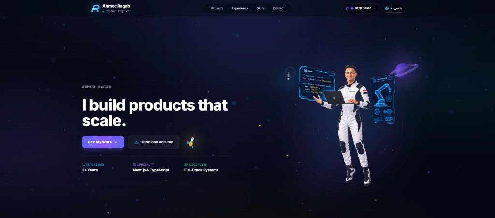
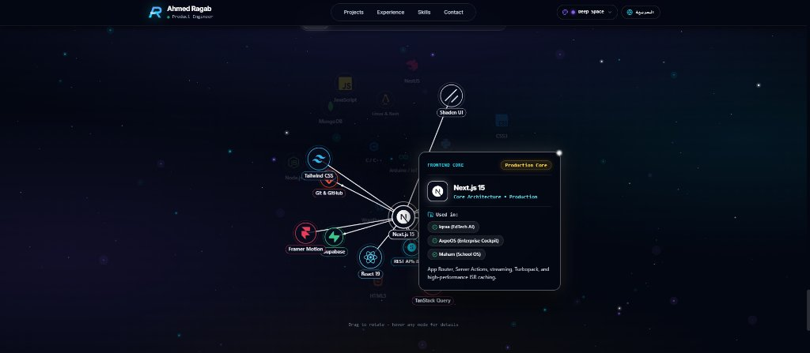
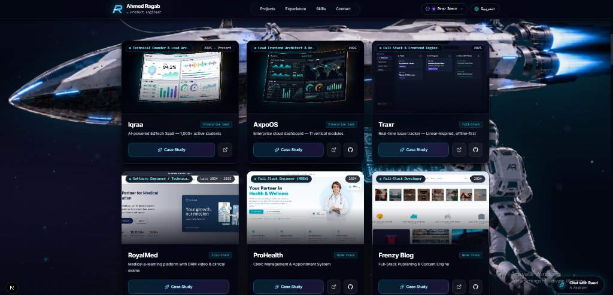
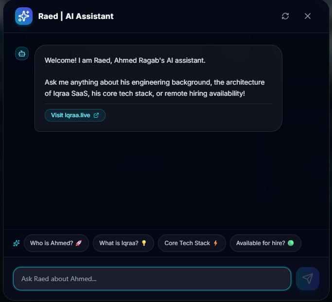

<div align="center">

# Ahmed Ragab — Personal Portfolio

**Full-Stack Product Engineer & Technical Founder**

[](https://ahmedragab.vercel.app)
[](https://iqraa.live)
[](https://github.com/dev-ahmed-ragab)
[](https://www.linkedin.com/in/ahmed-ragab-pro/)
[](mailto:ahmedragab.pro@outlook.com)

<br/>

*A cosmic-themed, single-page portfolio built with Next.js 15 & TypeScript — showcasing scalable systems, flagship SaaS products, and an embedded AI assistant (Raed).*

</div>

---

## 📸 Screenshots

<table>
  <tr>
    <td align="center" width="50%">
      <strong>Hero — "I build products that scale."</strong><br/><br/>
      
    </td>
    <td align="center" width="50%">
      <strong>Galaxy Skill Cloud (Interactive 3D Orbit)</strong><br/><br/>
      
    </td>
  </tr>
  <tr>
    <td align="center" width="50%">
      <strong>Projects — Orbital Stations Grid</strong><br/><br/>
      
    </td>
    <td align="center" width="50%">
      <strong>Raed — Embedded AI Assistant</strong><br/><br/>
      
    </td>
  </tr>
</table>

---

## ✨ Features

| Feature | Details |
|---------|---------|
| 🌌 **Cosmic Design System** | Deep space aesthetic with Framer Motion parallax, Lottie animations, and CSS nebula effects |
| 🤖 **Raed — AI Assistant** | Embedded chat widget powered by Gemini API with smart local fallbacks, rate-limited & streaming |
| 🌍 **Full i18n (AR / EN)** | RTL/LTR switching via `next-intl`, all content fully bilingual |
| ⚡ **Performance-First** | Dynamic code splitting per section, `loading="lazy"` on all below-fold images, sub-second builds |
| 📊 **Analytics** | PostHog session replay + Vercel Analytics & Speed Insights |
| 🔒 **Hardened API** | IP-based rate limiting, HTML escaping, server-only env vars, no exposed secrets |
| 📱 **Fully Responsive** | Mobile-first with Tailwind CSS, tested across all breakpoints |
| 🎨 **Dark / Light Theme** | System-aware with `next-themes`, persistent across navigation |
| 🔍 **SEO Optimized** | Schema.org JSON-LD (Person + SoftwareApplication), Open Graph, bilingual metadata |
| 📄 **CV Download** | Direct PDF download, tracked via PostHog `cv_downloaded` event |

---

## 🛠️ Tech Stack

```
Frontend         → Next.js 15 (App Router) · React 19 · TypeScript
Styling          → Tailwind CSS · shadcn/ui · Framer Motion · Lottie
Animations       → Framer Motion (parallax, scroll-linked) · CSS keyframes
i18n             → next-intl (AR + EN, RTL/LTR)
Icons            → Lucide React · simple-icons
AI Assistant     → Google Gemini API (server-side, rate-limited)
Email            → Resend API (server-side, HTML-escaped)
Analytics        → PostHog · Vercel Analytics · Vercel Speed Insights
Deployment       → Vercel (zero-config CI/CD, edge network)
```

---

## 🚀 Projects Showcased

| Project | Category | Stack | Status |
|---------|----------|-------|--------|
| [**Iqraa**](https://iqraa.live) — AI-powered EdTech SaaS | Enterprise SaaS | Next.js 15, NestJS, PostgreSQL, AI Agents | 🟢 Live — 1,000+ students |
| [**AxpoOS**](https://axpo-os.vercel.app) — Enterprise Cloud Cockpit | Enterprise SaaS | Next.js 16, React 19, TanStack Table, Zustand | 🟢 Live |
| **Traxr** — Linear-inspired Issue Tracker | Full-Stack | Next.js 15, Supabase Realtime, Offline-first | 🔵 In Development |
| **RoyalMed** — Medical E-learning Platform | Full-Stack | Next.js, DRM Video, PostgreSQL | 🟢 Live |
| **ProHealth** — Clinic Management & Booking | Full-Stack | MERN Stack, 3-panel dashboard | 🟢 Open Source |
| **Frenzy Blog** — Publishing & Content Engine | MERN Stack | React, Node.js, MongoDB | 🟢 Open Source |

---

## 🗂️ Project Structure

```
ahmed-ragab/
├── src/
│   ├── app/
│   │   ├── [locale]/               # i18n routes (en / ar)
│   │   │   ├── page.tsx            # Main single-page layout
│   │   │   ├── layout.tsx          # Root layout (PostHog, Analytics, Navbar, Footer)
│   │   │   ├── projects/[slug]/    # Dynamic project case study pages
│   │   │   └── experience/[slug]/  # Dynamic experience deep-dive pages
│   │   └── api/
│   │       ├── assistant/route.ts  # Raed AI assistant (Gemini, rate-limited)
│   │       └── contact/route.ts    # Contact form handler (Resend, rate-limited)
│   ├── components/
│   │   ├── sections/               # HeroSection, ProjectsSection, SkillsSection, ...
│   │   ├── cosmic/                 # CosmicCanvas, CosmicAssistantModal, LottiePlayer, ...
│   │   ├── layout/                 # Navbar, Footer
│   │   ├── providers/              # PostHogProvider
│   │   ├── analytics/              # AnalyticsProvider (Vercel)
│   │   ├── seo/                    # JsonLd (Schema.org)
│   │   ├── theme/                  # ThemeProvider, ThemeToggle
│   │   └── ui/                     # shadcn/ui primitives (badge, button, card, dialog, tabs)
│   ├── data/
│   │   ├── projects.ts             # All project entries (typed, bilingual)
│   │   ├── experience.ts           # Experience timeline entries
│   │   ├── skills.ts               # Skills categories
│   │   └── skillIconsData.ts       # Icon orbit data for GalaxySkillCloud
│   ├── config/
│   │   └── site.ts                 # Centralised site metadata (name, links, SEO)
│   ├── i18n/
│   │   ├── routing.ts              # Locale routing config
│   │   └── request.ts              # next-intl server request config
│   ├── messages/
│   │   ├── en.json                 # English translations
│   │   └── ar.json                 # Arabic translations
│   ├── lib/
│   │   ├── security.ts             # Rate limiting, HTML escaping, IP extraction
│   │   └── analytics.ts            # PostHog event helpers (trackDownloadCV, trackProjectClick)
│   └── styles/
│       └── globals.css             # Tailwind directives + cosmic CSS variables
├── public/
│   ├── assets/                     # Images, CV PDF, project screenshots
│   ├── lottie/                     # Lottie JSON animation files
│   ├── icons/skills/               # SVG skill icons for orbit cloud
│   ├── favicon.svg / favicon.ico
│   └── apple-touch-icon.png
├── .env.example                    # Environment variable template
├── next.config.ts
├── tailwind.config.ts
└── tsconfig.json
```

---

## ⚙️ Getting Started

### 1. Clone the repository

```bash
git clone https://github.com/dev-ahmed-ragab/ahmed-ragab.git
cd ahmed-ragab
```

### 2. Install dependencies

```bash
npm install
```

### 3. Set up environment variables

```bash
cp .env.example .env.local
```

Then fill in your keys in `.env.local`:

```env
# Google Gemini API — powers the Raed AI assistant
GEMINI_API_KEY=your_gemini_api_key_here

# Resend — powers the contact form email delivery
RESEND_API_KEY=your_resend_api_key_here
CONTACT_TO_EMAIL=your@email.com

# PostHog Analytics — session replay & funnel tracking
NEXT_PUBLIC_POSTHOG_KEY=phc_your_posthog_key
NEXT_PUBLIC_POSTHOG_HOST=https://us.i.posthog.com
```

> **Note:** The site works fully without any keys — the AI assistant falls back to curated local responses, the contact form logs submissions to the console, and analytics are simply skipped.

### 4. Run the development server

```bash
npm run dev          # Turbopack (recommended)
npm run dev:webpack  # Webpack fallback
```

Open [http://localhost:3000](http://localhost:3000).

### 5. Build for production

```bash
npm run build
npm run start
```

---

## 🔐 Security & Environment

| Item | Status |
|------|--------|
| `.env.local` in `.gitignore` | ✅ Never committed |
| `GEMINI_API_KEY` / `RESEND_API_KEY` | ✅ Server-only (never sent to browser) |
| `NEXT_PUBLIC_*` keys | ✅ Only analytics keys — no secrets |
| API Rate Limiting | ✅ IP-based sliding window (`/api/assistant`: 20 req/5min, `/api/contact`: 5 req/10min) |
| HTML Escaping | ✅ All contact form inputs escaped before email rendering |
| `AGENTS.md` | ✅ In `.gitignore` — excluded from repo |

---

## 🌍 Deployment on Vercel

This project is configured for zero-config Vercel deployment.

1. Push to GitHub
2. Import the repository in [vercel.com/new](https://vercel.com/new)
3. Add the following **Environment Variables** in Vercel's dashboard:

| Variable | Description |
|----------|-------------|
| `GEMINI_API_KEY` | Google AI Studio key |
| `RESEND_API_KEY` | Resend dashboard key |
| `CONTACT_TO_EMAIL` | Your receiving email |
| `NEXT_PUBLIC_POSTHOG_KEY` | PostHog project key |
| `NEXT_PUBLIC_POSTHOG_HOST` | `https://us.i.posthog.com` |

4. Deploy — Vercel handles CI/CD automatically on every push.

---

## 📬 Contact

| Channel | Link |
|---------|------|
| 📧 Email | [ahmedragab.pro@outlook.com](mailto:ahmedragab.pro@outlook.com) |
| 💼 LinkedIn | [linkedin.com/in/ahmed-ragab-pro](https://www.linkedin.com/in/ahmed-ragab-pro/) |
| 🐙 GitHub | [github.com/dev-ahmed-ragab](https://github.com/dev-ahmed-ragab) |
| 🎓 Iqraa | [iqraa.live](https://iqraa.live) |
| 📄 CV | [Download PDF](https://ahmedragab.vercel.app/assets/Ahmed_Ragab_CV.pdf) |

---

## 📄 License

This repository is **open source** and available under the [MIT License](LICENSE).

You are free to use this codebase as a reference or template for your own portfolio. If you do, a credit or a star ⭐ is appreciated but not required.

---

<div align="center">

Built with ☕ and a lot of TypeScript by **Ahmed Ragab**

*Mechatronics Engineering Student · Full-Stack Product Engineer · Technical Founder*

**Menoufia University, Egypt — Available Globally for Remote Contracts**

</div>
